```mermaid
graph TD
    subgraph Warga & Pengurus
        UserMobile["Smartphone Warga (Web App)"]
        AdminDesktop["Dashboard Pengurus & Satpam"]
    end

    subgraph Frontend Next.js 16
        NextApp["Next.js App Router (Turbopack)"]
        KtpModal["Modal Perekaman e-KTP Mandiri (Live RFID Radar)"]
        IoTSim["Hardware Live Simulator Panel (/iot)"]
    end

    subgraph Backend Laravel 11
        ApiRouter["REST API Gateway (Sanctum Auth)"]
        KtpEnroller["KTP Pairing Service (Cache & Anti-Duplikasi)"]
        AtomicDB["ACID Transaction (lockForUpdate Saldo)"]
        Reverb["Laravel Reverb (WebSockets S.O.S.)"]
    end

    subgraph Hardware: Single ESP32 DevKit V1 AIO
        ESP32Core["ESP32 DevKit V1 (FreeRTOS State Machine)"]
        Rfid1["Reader 1: Pos Satpam (GPIO 5)"]
        Rfid2["Reader 2: Kios Layanan / Bank Sampah (GPIO 4)"]
        GateServo["Servo SG90: Palang Pintu (GPIO 13)"]
        LcdDisplay["LCD 16x2 I2C: Display Info (GPIO 21/22)"]
        Hx711Scale["Load Cell 5kg + HX711: Timbangan (GPIO 16/17)"]
        PanicBtn["Push Button Merah: S.O.S. (GPIO 27)"]
        ModeBtn["Push Button Kuning: Mode Layanan (GPIO 14)"]
        BuzzerAudio["Active Buzzer: Indikator Audio (GPIO 25)"]
    end

    UserMobile --> NextApp
    AdminDesktop --> NextApp
    NextApp --> KtpModal
    NextApp --> IoTSim
    NextApp -->|REST API & Bearer Token| ApiRouter

    ESP32Core --> Rfid1
    ESP32Core --> Rfid2
    ESP32Core --> GateServo
    ESP32Core --> LcdDisplay
    ESP32Core --> Hx711Scale
    ESP32Core --> PanicBtn
    ESP32Core --> ModeBtn
    ESP32Core --> BuzzerAudio

    ESP32Core -->|POST /api/iot/ronda/tap| ApiRouter
    ESP32Core -->|POST /api/iot/bank-sampah/setor| ApiRouter
    ESP32Core -->|POST /api/iot/posyandu/catat| ApiRouter
    ESP32Core -->|POST /api/iot/panic-button| ApiRouter
    ESP32Core -->|POST /api/iot/ktp/scan| KtpEnroller
    ESP32Core -->|POST /api/iot/heartbeat| ApiRouter

    KtpModal -->|GET /api/warga/ktp/latest-scan & POST /pair| KtpEnroller
    ApiRouter --> AtomicDB
    ApiRouter -->|Broadcast Darurat| Reverb
```

# SMART-WARGA — Digital Management System & Single ESP32 IoT Hub
### Integrated Civic Operating System • Smart Neighborhood & IoT Automation (RW & RT)

[](https://laravel.com)
[](https://nextjs.org)
[](https://espressif.com)
[](https://herd.laravel.com)
[](backend/tests/Feature)

Platform tata kelola lingkungan terpadu untuk rukun warga tingkat RW & RT modern. Mengintegrasikan **Next.js 16 (Turbopack)** pada antarmuka web warga, **Laravel 11 REST API** dengan proteksi transaksi atomik, dan **1 Unit Mikrokontroler ESP32 DevKit V1 (All-in-One Controller)** yang mengendalikan seluruh sistem fisik lingkungan: palang gerbang pos satpam, alarm darurat panic button, timbangan bank sampah, posyandu mandiri, serta fitur **Perekaman Mandiri e-KTP Warga**.

---

## 📚 Buku Panduan Resmi & Dokumentasi Akademis

Dokumentasi lengkap perakitan fisik, diagram pengkabelan, alur komunikasi REST API, dan analisis akademis pencegahan antrean telah dikompilasi dalam format PDF resmi:

👉 **[Buku_Panduan_IoT_ESP32_SMART_WARGA.pdf](Buku_Panduan_IoT_ESP32_SMART_WARGA.pdf)**  
*(Tersedia juga salinannya di dalam folder firmware: [`firmware/smartwarga_single_esp32_aio/Buku_Panduan_IoT_ESP32_SMART_WARGA.pdf`](firmware/smartwarga_single_esp32_aio/Buku_Panduan_IoT_ESP32_SMART_WARGA.pdf))*

---

## 🏛️ Arsitektur Monorepo & Topologi Sistem

```
smartwarga/
├── Buku_Panduan_IoT_ESP32_SMART_WARGA.pdf  → Buku Panduan Master PDF (9 Halaman Siap Cetak/Uji Sidang)
├── backend/                                 → Laravel 11 REST API, Sanctum RBAC, Reverb WebSockets, DomPDF
├── frontend/                                → Next.js 16 (App Router), Tailwind CSS, Lucide Icons, Turbopack
├── firmware/
│   ├── smartwarga_single_esp32_aio/        → [RESMI] Firmware All-in-One untuk 1 Board ESP32 (4 Mode Operasional)
│   └── smartwarga_esp32_ktp_enroller/      → [OPSIONAL] Dedicated Desk Scanner ESP32 Khusus Meja Administrasi
└── docs/                                    → Arsip PDF dan panduan pendukung
```



---

## ⚡ Arsitektur Resmi: Single ESP32 All-in-One (Opsi 1)

Sistem dirancang secara cerdas agar **TIDAK MEMBUTUHKAN BANYAK ESP32 (HEMAT ANGGARAN & IDEAL UNTUK SIDANG PENGUJIAN)**. Seluruh fungsionalitas dijalankan oleh **1 board ESP32 DevKit V1**:

### 4 Mode Operasional Kios (Dapat Diganti via Tombol Mode GPIO 14):
1. **Mode 1: `MD:BS-PLASTIK >`** &mdash; Timbangan bank sampah plastik (Tarif: Rp 2.000 / kg).
2. **Mode 2: `MD:BS-KALENG  >`** &mdash; Timbangan bank sampah kaleng (Tarif: Rp 5.000 / kg).
3. **Mode 3: `MD:POSYANDU   >`** &mdash; Pencatatan mandiri berat badan balita untuk KMS digital.
4. **Mode 4: `MD:DAFTAR-KTP >`** &mdash; **Perekaman Mandiri e-KTP Warga** (Tap kartu untuk langsung memasangkan identitas ke akun web).

*Catatan:* Di samping 4 mode kios di atas, **Reader 1 (Gerbang Masuk) dan Tombol Panik Darurat (GPIO 27) selalu aktif stand-by 24/7** secara non-blocking (*interrupt driven*).

---

## 🔌 Panduan Pengkabelan (Wiring Pin-by-Pin Bebas Konflik)

> [!CAUTION]
> **ATURAN TEGANGAN KRUSIAL (PENCEGAHAN KERUSAKAN CHIP):**
> * **Modul RFID RC522 HANYA MENGGUNAKAN TEGANGAN 3.3V:** Hubungkan pin VCC kedua modul RFID <u>hanya ke pin 3V3 ESP32</u>. Menyambungkan ke 5V akan merusak modul RFID secara permanen.
> * **Servo SG90 & LCD 16x2 WAJIB TEGANGAN 5V:** Hubungkan VCC Servo dan LCD ke pin **VIN (5V)** ESP32 (daya USB). Jika disambung ke 3.3V, servo tidak kuat bergerak dan teks LCD menjadi redup/gelap.
> * **Common Ground:** Seluruh GND modul harus disatukan ke rel ground breadboard.

| Periferal | Pin Modul | Pin ESP32 DevKit V1 | Protokol | Keterangan & Catatan |
|---|---|---|---|---|
| **Catu Daya 3.3V** | Rel Positif (+) | **Pin 3V3** | Power Line | Khusus VCC Reader 1 dan VCC Reader 2 |
| **Catu Daya 5.0V** | Rel Positif (+) | **Pin VIN (5V)** | Power Line | Mencatu VCC Servo, LCD 16x2, dan HX711 |
| **Ground (GND)** | Rel Negatif (-) | **Pin GND** | Common GND | Satukan seluruh kaki GND komponen |
| **RFID Reader 1 (Gerbang)** | SDA (SS)<br>SCK<br>MOSI<br>MISO<br>RST<br>VCC / GND | **GPIO 5**<br>GPIO 18<br>GPIO 23<br>GPIO 19<br>GPIO 26<br>3V3 / GND | SPI Bus | Chip Select 1 (Pos Ronda & Gerbang)<br>Shared SPI Clock<br>Shared Master Out Slave In<br>Shared Master In Slave Out<br>Shared Reset Pin<br>**3.3V Only!** |
| **RFID Reader 2 (Kios)** | SDA (SS)<br>SCK, MOSI, MISO<br>RST<br>VCC / GND | **GPIO 4**<br>GPIO 18, 23, 19<br>GPIO 26<br>3V3 / GND | SPI Bus | Chip Select 2 (Kios Bank Sampah & Posyandu)<br>Jalur SPI paralel bersama Reader 1<br>Jalur reset paralel bersama Reader 1<br>**3.3V Only!** |
| **Servo Motor SG90** | PWM (Kuning/Oranye)<br>VCC (Merah)<br>GND (Cokelat/Hitam) | **GPIO 13**<br>VIN (5V)<br>GND | PWM Control | Sudut: 0° (Tertutup), 90° (Terbuka 4 Detik)<br>Wajib 5V agar torsi mengangkat palang kuat |
| **LCD 16x2 + I2C** | SDA<br>SCL<br>VCC / GND | **GPIO 21**<br>GPIO 22<br>VIN (5V) / GND | I2C Bus | Serial Data (Alamat I2C: `0x27` / `0x3F`)<br>Serial Clock<br>Wajib 5V agar lampu latar terang |
| **Load Cell 5kg + HX711** | DT (Data)<br>SCK (Clock)<br>VCC / GND | **GPIO 16**<br>GPIO 17<br>VIN (5V) / GND | 2-Wire Serial | Serial data ADC 24-bit timbangan presisi<br>Clock konversi<br>Daya modul HX711 |
| **Tombol Panik (Merah)** | Kaki 1 ke GPIO, Kaki 2 ke GND | **GPIO 27** | INPUT_PULLUP | Ditekan = LOW (Sirine & Alert Darurat Aktif) |
| **Tombol Mode (Kuning)** | Kaki 1 ke GPIO, Kaki 2 ke GND | **GPIO 14** | INPUT_PULLUP | Ditekan = LOW (Rotasi 4 Mode Operasional Kios) |
| **Active Buzzer 5V** | Positif (+)<br>Negatif (-) | **GPIO 25**<br>GND | Digital Output | Bip Konfirmasi (2x) & Sirene Peringatan |

### Sambungan Kabel Load Cell 4-Warna ke Modul HX711:
* **Kabel Merah** $\rightarrow$ Terminal `E+` (Excitation +)
* **Kabel Hitam** $\rightarrow$ Terminal `E-` (Excitation -)
* **Kabel Putih** $\rightarrow$ Terminal `A-` (Signal -)
* **Kabel Hijau** $\rightarrow$ Terminal `A+` (Signal +)

---

## 🎓 Analisis Akademis & Penanganan Kasus Tabrakan Antrean (Sidang Dosen)

Dokumen ini memuat solusi teknis atas 6 skenario kegagalan antrean (*edge cases*) yang sering ditanyakan dosen penguji:

### 1. Proteksi Palang Menabrak Kendaraan/Warga (*Gate Collision Protection*)
* **Masalah:** Palang turun saat kendaraan warga masih melintas.
* **Solusi SMART-WARGA:**
  1. *Hold-Open Timer (4000ms):* Memberikan jendela waktu aman yang cukup bagi kendaraan roda dua/empat melintas.
  2. *Torque-Safe Micro Actuator:* Servo SG90 memiliki batas torsi aman (&plusmn;1.8 kg/cm). Jika palang terhalang atap mobil atau kepala warga, motor servo berhenti tanpa mencederai manusia atau merusak bodi mobil.

### 2. Antrean Beruntun di Gerbang (*Anti-Tailgating & FIFO Logging*)
* **Masalah:** Warga B men-tap kartu saat gerbang masih terbuka karena Warga A.
* **Solusi SMART-WARGA:**
  Firmware mendeteksi tap valid saat servo berada pada posisi 90°, seketika mereset timer hold-open (+4000ms perpanjangan) dan tetap mengirim HTTP request untuk Warga B. Kedua warga tercatat independen pada tabel `ronda_logs`, dan palang gerbang tidak terbanting menutup mendadak di antara kedua kendaraan (*anti-slamming*).

### 3. Pencegahan Double-Tap Tak Sengaja (*Accidental Double-Tap Debouncing*)
* **Masalah:** Kartu ditempel terlalu lama atau tangan bergetar sehingga UID terbaca berulang kali dalam milidetik.
* **Solusi SMART-WARGA:**
  *Filter Lapis Ganda:* Firmware mengeksekusi `PICC_HaltA()` dan delay 500ms, sementara Backend mengecek transaksi terakhir dalam 5 detik terakhir. Jika UID yang sama terdeteksi berulang, backend mengabaikan request duplikat secara idempoten (*Idempotency Guard*).

### 4. Antrean di Kios Timbangan Bank Sampah (*Zero-Load Enforcement & ACID Lock*)
* **Masalah:** Warga B menaruh kantong sampah sebelum sesi Warga A selesai dihitung.
* **Solusi SMART-WARGA:**
  1. *Zero-Load Verification:* Kios mewajibkan timbangan kembali ke kondisi stabil mendekati nol (< 20 gram) sebelum transaksi warga berikutnya diizinkan. Jika beban belum diangkat, LCD menampilkan `ANGKAT SAMPAH!` dan menolak tap berikutnya.
  2. *Database Concurrency Locking:* Pada `IoTController.php`, mutasi saldo e-wallet dibungkus dalam `DB::transaction()` dengan pemanggilan `lockForUpdate()`, menjamin integritas saldo dan audit kas secara mutlak tanpa resiko *double-credit*.

### 5. Pencegahan Tabrakan Bus SPI Dua RFID Reader (*Hardware Bus Contention*)
* **Masalah:** Dua modul RFID RC522 berbagi jalur bus SPI fisik bersama (SCK=18, MISO=19, MOSI=23). Bagaimana jika dua kartu di-tap bersamaan?
* **Solusi SMART-WARGA:**
  Penerapan *Time-Division Multiplexing (TDM)* dengan isolasi sinyal Chip Select (CS). Reader 1 dikendalikan GPIO 5, Reader 2 dikendalikan GPIO 4. Firmware mengaktifkan pin CS bergantian secara eksklusif (hanya satu pin yang `LOW` pada satu siklus). Ketika satu reader dibaca, reader pasif berada dalam mode *High-Impedance (Hi-Z)*, sehingga **tabrakan sinyal data SPI secara elektrik mustahil terjadi**.

### 6. Redaman Banjir Penekanan Tombol Darurat (*Panic Button Flooding Filter*)
* **Masalah:** Warga panik menekan tombol darurat berkali-kali dalam 1 detik.
* **Solusi SMART-WARGA:**
  Penerapan *Interrupt Debounce Timer (3000ms)*. Penekanan pertama langsung membunyikan sirine dan mengirim sinyal HTTP POST ke server, sementara penekanan berulang dalam jendela 3 detik diredam tanpa membebani server backend dengan banjir request darurat (*DDoS mitigation*).

---

## 📲 Alur Perekaman Mandiri e-KTP Warga (Self-Service e-KTP Pairing)

Fitur ini memfasilitasi warga agar dapat mendaftarkan fisik kartu e-KTP mereka secara mandiri:

1. **Akses Dashboard Warga:** Warga membuka aplikasi SMART-WARGA di smartphone mereka (`/dashboard`).
2. **Klik Tombol Aktivasi:** Warga menekan tombol **`[ 📲 Pindai & Tautkan e-KTP Mandiri ]`** pada banner beranda.
3. **Radar RFID Aktif Mendengarkan:** Modal menampilkan radar animasi yang aktif melakukan polling ke `/api/warga/ktp/latest-scan`.
4. **Tap e-KTP di Scanner ESP32:** Warga menempelkan e-KTP ke sensor ESP32 (Single AIO Mode `MD:DAFTAR-KTP >` atau unit scanner meja).
5. **Deteksi Instan:** Dalam 1 detik, radar web bergetar hijau menampilkan:  
   `KARTU e-KTP TERDETEKSI: 04A1B2C3 • Status: Siap Ditautkan`.
6. **Simpan ke Akun:** Warga menekan **`[ Tautkan e-KTP ke Akun Saya ]`**. Sistem mengecek keunikan kartu di database lalu mengikatkan `rfid_uid` tersebut secara permanen ke akun warga.
7. **Aktif Seketika:** Kartu fisik tersebut detik itu juga dapat langsung membuka gerbang perumahan dan setor bank sampah otomatis.

---

## 🛠️ Panduan Menjalankan Sistem Secara Lokal

### 1. Menjalankan Backend (Laravel 11 + Herd)
```bash
cd backend
composer install
cp .env.example .env
php artisan key:generate
php artisan migrate --seed
php artisan test
```

### 2. Menjalankan Frontend (Next.js 16 + Turbopack)
```bash
cd frontend
npm install
npm run dev
# Buka di browser: http://localhost:3000
```

### 3. Meng-upload Firmware ke ESP32 (Arduino IDE)
1. Buka Arduino IDE, tambahkan Board Manager URL ESP32:  
   `https://raw.githubusercontent.com/espressif/arduino-esp32/gh-pages/package_esp32_index.json`
2. Pasang library wajib: `MFRC522`, `LiquidCrystal_I2C`, `ESP32Servo`, dan `ArduinoJson`.
3. Buka file [`firmware/smartwarga_single_esp32_aio/smartwarga_single_esp32_aio.ino`](firmware/smartwarga_single_esp32_aio/smartwarga_single_esp32_aio.ino).
4. Sesuaikan `WIFI_SSID`, `WIFI_PASSWORD`, dan `API_BASE_URL`.
5. Pilih Board: **ESP32 Dev Module** dan Port USB, lalu klik **Upload**.

---

## 🧪 Hasil Verifikasi & Uji Otomatisasi (Test Matrix)

Seluruh logika bisnis, transaksi dompet atomik, dan validasi hardware telah terverifikasi melalui test suite otomatis Laravel PHPUnit:

```
Tests:    119 passed (554 assertions)
Duration: 2.12s
Status:   100% PASS
```

* **White-Box Testing:** State-machine gerbang, formula timbangan sampah kaleng/plastik, pembagian kas RT (60%) & RW (40%), atomic row locking saldo e-wallet, de-aktivasi sirine, dan proteksi duplikasi KTP.
* **Black-Box Testing:** Format respons teks LCD 16 karakter (`lcd_line1` dan `lcd_line2`), status kode HTTP REST API, otentikasi Sanctum RBAC, serta filtering offline hardware.

---

## 📄 Lisensi & Hak Cipta
Dokumentasi dan kode sumber dikembangkan untuk **SMART-WARGA Ecosystem Platform**.  
Hak Cipta &copy; 2026 Management System Hub. Seluruh hak cipta dilindungi undang-undang.
